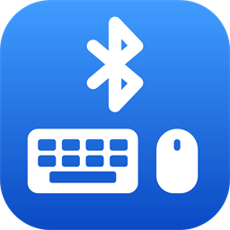

# BleHid: Bluetooth Keyboard and Mouse Sharing for Windows



Turn a Windows PC into a Bluetooth Low Energy keyboard and mouse, so it can drive other
devices over the air. No extra hardware, no software installed on the receiving device —
it pairs like any ordinary Bluetooth keyboard.

Built entirely on the in-box Windows BLE stack (WinRT `GattServiceProvider`), implementing
the standard HID over GATT Profile (HOGP).

> **Status: working spike.** The core functionality is verified against real devices, but
> there are real limitations — see [Known issues](#known-issues) before relying on it.
> Everything below was measured on actual hardware; unverified claims are marked as such.

Implementation constraints, packet traces, experiments, and falsified hypotheses live in
[DEVELOPMENT.md](DEVELOPMENT.md).

---

## What it does

- **Redirects your real keyboard and mouse** to the paired device via low-level Win32
  hooks — the `capture` command, and the main way you use the app. Input is swallowed
  locally while redirecting.
- Exposes the PC as a **composite BLE HID device** — keyboard (Report ID 1) and mouse
  (Report ID 2) in a single HOGP service.
- **Multiple hosts at once.** Several devices can be paired and connected simultaneously.
- **Per-host switching** with a hotkey, including a "this PC" position so you can hop
  between your own machine and the remotes without stopping capture.
- **Scriptable CLI** for sending individual keystrokes, text, pointer moves, clicks and
  scrolling.
- **Diagnostics** for connection state, subscriber counts, link timing and platform
  capability probes.

---

## Requirements

- Windows 10 2004 (build 19041) or later
- A Bluetooth radio that supports the **LE peripheral role** — the app reports this at
  startup; if it says `Peripheral=False`, nothing else will work. See [Adapter
  compatibility](#adapter-compatibility) for what has been tested
- [.NET SDK 8.0](https://dotnet.microsoft.com/download) **only if building from source**;
  the prebuilt downloads do not require a separate .NET installation

---

## Download

Download a package from the [latest release](../../releases/latest). Choose `win-x64`
for Intel/AMD Windows PCs or `win-arm64` for Windows on Arm.

| Interface | Archive | Run |
| --- | --- | --- |
| **Desktop app (recommended)** | `BleHid-App-<version>-<rid>.zip` | `BleHid.App.exe` |
| Command line | `BleHid-Cli-<version>-<rid>.zip` | `BleHid.Cli.exe` |

Both packages are **self-contained**: no .NET runtime or SDK installation is needed to
run them. For the desktop app, **extract the entire archive and keep the bundled DLLs
beside `BleHid.App.exe`**; do not copy the executable out on its own. The CLI executable
is a single portable file.

The arm64 build has been verified on a Snapdragon-based Surface laptop, including
`capture` driving a remote host.

The binaries are **unsigned**, so SmartScreen will warn on first launch
(*More info → Run anyway*). Build from source if you would rather not trust them.

---

## Quick start

### Desktop app (recommended)

1. Extract the desktop archive and run `BleHid.App.exe`.
2. Open **Status** and click **Start** if the peripheral is not already running.
3. On the device you want to control, pair with the PC from its Bluetooth settings. The
   PC appears under its own hostname. A Windows host lists the same machine twice; pick the
   entry shown as a **PC**, not the audio one, or the bond lands on Classic and nothing
   works ([details](#a-windows-host-can-pair-to-the-wrong-entry)).
4. Open **Capture**, wait for the paired device to appear under **Send input to**, and
  select it. Turn on **Capture keyboard and mouse** to redirect your input to that device.

### Command line

Run only one front end at a time. Before starting the CLI, choose **Exit** from the desktop
app's notification-area menu; closing its window may only hide it.

1. Extract the CLI archive and run `BleHid.Cli.exe`. It publishes the GATT services and
  starts advertising immediately.
2. Pair with the PC from the target device's Bluetooth settings, using the input-device
  entry rather than the audio one on Windows as described above.
3. Type **`capture`** and press Enter.

### Capture shortcuts

While driving a host, your real keyboard and mouse go to that device instead of this PC.
The same shortcuts work in the desktop app and interactive CLI:

| While capturing | |
| --- | --- |
| `Ctrl` + `Alt` + `Q` | Stop and return control to this PC |
| `Ctrl` + `Alt` + `CapsLock` or `Ctrl` + `D` + `C` | Switch which device you are driving, including back to this PC |

The CLI also offers scripted input (`type`, `move`) and diagnostics.

---

## Frequently asked questions

### Does BleHid need Wi-Fi or an internet connection?

No, not for keyboard and mouse input. Once installed and paired, BleHid sends input
directly over Bluetooth Low Energy. The devices do not need Wi-Fi, a shared local network,
or an internet connection to exchange input.

### Do I need to install an app on the receiving device?

No. Compatible receiving devices use their built-in Bluetooth HID support, just as they
would with an ordinary Bluetooth keyboard and mouse. The optional
[Android companion](#android-companion-experimental) adds connection monitoring and
diagnostics; it is not required to receive input and is not a guaranteed reconnect fix.

### Which devices can I control with my Windows keyboard and mouse?

BleHid runs on the Windows PC supplying the input. Tested receiving devices include
Android 16 phones, macOS, Windows 11, and iPhones. On iPhone, mouse input needs
**AssistiveTouch** enabled.

Compatibility is not universal: input failed on the tested Android 11 phone, the tested
Samsung TV could not pair, and iPadOS and Linux remain untested. Android and Windows hosts
also have known reconnect limitations after BleHid restarts. See the
[host compatibility table](#host-compatibility) and [known issues](#known-issues) before
choosing a setup.

---

## Languages

BleHid is available in English, German (Deutsch) and Simplified Chinese (简体中文). The
Chinese translation builds on [@Vierblatt](https://github.com/Vierblatt)'s work; see the
[translation credits](TRANSLATING.md#credits).

- **Desktop app:** follows the Windows display language. Choose another in **Settings →
  Language**; it applies the next time BleHid starts.
- **Command line:** follows the Windows display language, or use `--lang de` or the
  `BLEHID_LANG` environment variable. Command names stay in English.
- **Android companion:** follows the phone's language.

Logs and diagnostic reports stay in English, so maintainers can read them in bug reports.

**Help translate:** no Git or coding is needed. Copy the English text, translate it, and
paste it into a [translation issue](https://github.com/abhishek-raj/windows-ble-hid/issues/new?template=translation.yml).
A bot checks it, and once approved, your translation is added with you credited as a
co-author. See [TRANSLATING.md](TRANSLATING.md).

---

## Android companion (experimental)

The source-only Android companion in [android/BleHid.Companion](android/BleHid.Companion)
adds connection monitoring and diagnostics for Android 12 or later. It can:

- associate with a BleHid computer through Android's Companion Device Manager;
- keep an app-owned BLE GATT connection active in a foreground service;
- inspect HOGP presence, report count, Service Changed events, and Database Hash changes;
- retry failed GATT connections with bounded backoff and export a diagnostic timeline;
- request a system Bluetooth-profile reconnect on Android 17 or later.

Android 12-16 do not expose the profile reconnect API to companion apps. On those versions,
the recovery action opens the computer's Bluetooth settings so you can tap **Connect**.
The companion cannot directly repair Android's system HID cache or lost HID report
subscriptions. It intentionally does not subscribe to the HID report characteristics,
because an app-owned subscription is separate from Android's system input path.

In two measured Android 16 trials, its presence-triggered GATT connection did nevertheless
bootstrap a full automatic HOGP reconnect after the Windows provider restarted: Android
reread the HID metadata and restored both report subscriptions without a Connect tap. This
is an experimental workaround based on connection ordering, not a guaranteed platform fix;
manual Connect and re-pairing remain the fallback.

Build and install the debug APK:

```powershell
cd android\BleHid.Companion
.\gradlew.bat :app:assembleDebug
.\gradlew.bat :app:installDebug
```

See the [Android companion README](android/BleHid.Companion/README.md) for setup and design
details.

---

## Background mode

Two reasons to use it. Convenience: the peripheral is already up and the hotkeys already
live, so switching to another machine costs one keystroke instead of opening a console and
starting a session. And it sidesteps the [Windows reconnect
limitation](#a-windows-host-will-not-reconnect-after-the-app-restarts) — one long-lived
peripheral means no restarts for a bonded host to fail to recover from.

```powershell
BleHid.Cli.exe --background          # run detached, no console window
BleHid.Cli.exe --stop                # shut it down
BleHid.Cli.exe --install-autostart   # run at login (per-user, no admin)
BleHid.Cli.exe --remove-autostart
```

Auto-start is opt-in. Nothing is written to the `Run` key unless you run
`--install-autostart` yourself, and `--remove-autostart` undoes it.

It starts on the **local** target, so your keyboard and mouse behave normally until you
pick a host. From there it is hotkeys only — there is no console to type into:

| Hotkey | Action |
| --- | --- |
| `Ctrl` + `Alt` + `CapsLock` or `Ctrl` + `D` + `C` | Switch target: this PC → host 1 → … → host N → this PC |
| `Ctrl` + `Alt` + `Q` | Return input to this PC (does **not** exit — use `--stop`) |

If the selected host disconnects, capture automatically returns input to this PC instead
of continuing to swallow it. Reconnecting the host does not retarget it automatically;
use `Ctrl` + `Alt` + `CapsLock` (or `Ctrl` + `D` + `C`) when you are ready to switch back.

Only one instance runs at a time; a second `--background` is refused. Output goes to
`%LOCALAPPDATA%\BleHid\logs\blehid.log`.

### Pointer pacing overrides

On Windows 11, pointer reports follow each selected host's negotiated BLE connection
interval. Windows 10 uses the configured minimum because the operating system does not
expose the negotiated value. To choose a slower interval for a particular host, create
`%LOCALAPPDATA%\BleHid\pointer-pacing.json`:

```json
{
  "defaultMinimumIntervalMs": 10,
  "hostMinimumIntervalMs": {
    "Example Phone": 30,
    "Example Mac": 15
  }
}
```

Host names are matched case-insensitively, so overrides survive forgetting and re-pairing.
Names are not guaranteed unique; devices with the same name share an override. The effective
interval is the greatest of the negotiated interval, the app or CLI minimum, the file default,
and the host override. Higher values reduce controller queueing but can make motion choppier.

The interactive console cannot run at the same time — both would try to publish the same
GATT service. Run `--stop` first when you need the diagnostics.

---

## Build and run

Building from source requires the [.NET SDK 8.0](https://dotnet.microsoft.com/download).
It is not needed for the prebuilt packages above.

Desktop app:

```powershell
dotnet build src\BleHid.App\BleHid.App.csproj
dotnet run   --project src\BleHid.App\BleHid.App.csproj
```

Command line:

```powershell
dotnet build src\BleHid.Cli\BleHid.Cli.csproj
dotnet run   --project src\BleHid.Cli\BleHid.Cli.csproj
```

Run one front end at a time, then follow its [quick start](#quick-start) above.

Run the CLI with `--plain` to drop the encryption requirement on the HID characteristics. HOGP
mandates encryption, so this is a diagnostic aid rather than a normal mode.

**Note:** a running app locks its assemblies. Choose **Exit** from the desktop app's
notification-area menu, or type `quit` in the CLI, before rebuilding to avoid `MSB3026`.

---

## Commands

### Main

| Command | Description |
| --- | --- |
| **`capture`** | **Redirect the local keyboard and mouse — the primary command** |
| `capture verbose` | Same, with per-report timing diagnostics |
| `capture <ms>` | Same, with a custom pointer report interval |
| `host` | List subscribed hosts and the current target |
| `host <n\|next\|local\|all>` | Choose the target |
| `gesture` | Show whether shake-to-switch is on |
| `gesture <on\|off>` | Toggle shake-to-switch; applies to a running session |
| `status` | Advertisement state, subscriber counts, current target, lock keys |
| `quit` | Exit |

### Hotkeys while capturing

| Hotkey | Action |
| --- | --- |
| `Ctrl` + `Alt` + `CapsLock` or `Ctrl` + `D` + `C` | Switch target: this PC → host 1 → … → host N → this PC |
| `Ctrl` + `Alt` + `Q` | Stop capturing |

When the target is **this PC**, input passes through untouched so you can use your own
machine normally. The hotkeys stay live in that mode.

`Ctrl` + `Alt` + `CapsLock` cycles once per Caps Lock press without toggling Caps Lock
locally or on the host. Ordinary Caps Lock presses are unchanged.

### Shake to switch

Shaking the pointer rapidly back and forth also cycles the target, so you can switch without
reaching for the keyboard. It is **off by default** — turn it on with `gesture on`, the
**Settings** page in the app, or by editing `%LOCALAPPDATA%\BleHid\switch-gesture.json`:

```json
{
  "Enabled": true,
  "MinStrokePx": 80,
  "RequiredReversals": 3,
  "WindowMs": 250
}
```

| Setting | Range | Effect |
| --- | --- | --- |
| `MinStrokePx` | 20–500 | Travel needed for one sweep to count. Lower is easier to trigger |
| `RequiredReversals` | 2–10 | Direction changes needed. 3 means four strokes |
| `WindowMs` | 100–5000 | All reversals must land within this. Lower demands a faster shake |

The file is watched, so a change applies to a running session — including background mode,
which is a separate process. A short window is the strongest defence against false
positives: ordinary pointer movement never reaches that speed. Out-of-range values are
clamped and the clamping is logged.

The gesture is a convenience; the hotkeys above remain the guaranteed way to switch.

### Lock key state

Caps Lock on a host you cannot see is invisible until you have typed a line in the wrong
case. BleHid reports it in the log on every switch, in `host` and `status`, on the Capture
page, and in the tray tooltip.

Where the host writes the HID LED output report — confirmed on Android 16 — the state is
**measured**. Otherwise it is **inferred** from the lock keys sent to that host, which is
usually right but cannot correct itself. The CLI labels which one you are looking at.

Num Lock is tracked the same way, but only reported once the numpad has actually been used
on that host: hosts with no Num Lock key report it permanently off, and warning about that
unprompted would never clear. Scroll Lock is not tracked.

Numpad keys are resolved from the physical key rather than the virtual key Windows derives
from it, so **this PC's Num Lock no longer decides what the remote receives**. A real
keyboard has no Num Lock state of its own; it reports the key and lets the host apply its
own setting, and BleHid now does the same. Keypad Enter is sent as Keypad Enter rather than
as the main Enter.

### Scripted input

Useful for automation or for testing the link without handing over your keyboard.

| Command | Description |
| --- | --- |
| `type <text>` | Send a string as keystrokes |
| `key <name>` | Press a named key (`enter`, `esc`, `up`, `f5`, …) |
| `move <dx> <dy>` | Move the pointer |
| `click <l\|r\|m>` | Click a mouse button |
| `scroll <n>` | Scroll the wheel |

### Diagnostics

| Command | Description |
| --- | --- |
| `peers` | List connected Bluetooth peers (LE and Classic) |
| `burst <n>` | Time *n* raw notifications — link diagnostic |
| `watch <secs>` | Log connection and subscription changes as they happen |
| `probe <uuid16>` | Try to create a GATT service, e.g. `probe 1801` |
| `l2cap` | Test whether user mode can open Classic HID L2CAP PSMs |
| `appearance` | Attempt to advertise GAP appearance = keyboard |
| `classic <on\|off>` | Attempt to toggle BR/EDR connectable |

---

## Host compatibility

Measured on real devices. Absence from this table means untested, not unsupported.

| Host | Pairs | Input works | Reconnects after app restart | Reports lock keys |
| --- | --- | --- | --- | --- |
| macOS | Yes | Yes | **Yes** — automatic | Untested |
| Android 16 (Galaxy S24 FE) | Yes | Yes | Automatic while the app stays running; manual after app restart | **Yes** — measured |
| Android 11 (Galaxy S20 FE) | Yes | **No** — binds BR/EDR instead of LE | — | — |
| Windows 11 | Yes — **pick the right entry**, see below | Yes | **No** — see below | Untested |
| iOS (iPhone) | Yes | Yes — pointer needs **AssistiveTouch**, see below | Untested | Untested |
| iPadOS | Untested | | | |
| Linux | Untested | | | |
| Samsung TV (Tizen) | **No** — the PC never appears in its device list | — | — | — |
| Consoles, BIOS/UEFI | Untested — boot protocol is not implemented | | | |

"Reports lock keys" means the host writes the HID LED output report, so Caps Lock and Num
Lock state is **measured**. Hosts that do not fall back to inferring it from the keystrokes
sent to them, which is usually right but cannot self-correct.

Boot protocol is not implemented — there are no Boot Keyboard Input/Output characteristics
(`0x2A22` / `0x2A32`). A host that insists on boot protocol, which is the usual case for
BIOS/UEFI, will not get input.

Older Android builds attach to the PC's Classic radio rather than the LE peripheral and
never bind HOGP. Newer builds handle it correctly. The cutoff between the two has not been
narrowed down.

A phone listing the PC under **Phone calls** and **Media audio** is normal and does not
mean anything went wrong — the PC is dual-mode, so its Classic profiles show up whether or
not the HID service bound. What tells you HOGP actually attached is an **Input device**
entry alongside those two. If Phone calls and Media audio are the only options, the phone
bound Classic only.

The Samsung TV does not list the PC, so pairing cannot begin. The likely reason is that the
TV filters for peripherals that advertise as a keyboard or mouse, while Windows identifies
the radio as a computer. Desktop apps cannot change that system-owned identity.

iOS accepts the keyboard immediately, but draws no pointer for the mouse until **Settings
→ Accessibility → Touch → AssistiveTouch** is enabled. Confirmed on an iPhone: with
AssistiveTouch on, the pointer appears and tracks. Nothing is wrong with the report
descriptor — iOS simply has no cursor without that setting.

---

## Adapter compatibility

The radio on *this* PC has to support the LE peripheral role. Most do; the cheap ones
often do not. Measured, and again not exhaustive — this is what I happened to have access
to, not a shortlist worth buying from:

| Adapter | Works |
| --- | --- |
| ASUS USB-BT500 (USB dongle) | Yes |
| ThinkPad P14s built-in radio | Yes |
| Surface (ARM) built-in radio | Yes |
| Intel Wireless Bluetooth | Yes |
| Generic no-name dongle, enumerates as a CSR radio | **No** |

The CSR dongle reports Bluetooth Core Specification 4.0, which is high enough on paper —
BLE and HOGP both arrived in 4.0 — but it never worked in practice. Supporting a spec
version is not the same as supporting the peripheral role, and these generic dongles are a
known weak spot.

If you need to buy one, the rule of thumb is to avoid anything that only claims 4.0 or
shows up as a generic CSR radio, and prefer a dongle that names its chipset and advertises
5.0 or later.

Run `BleHid.Cli.exe --diagnose` to check your own: if it reports `Peripheral role : False`,
that radio cannot act as a keyboard and no amount of pairing will fix it.

To find the spec version your radio claims, follow Microsoft's instructions for [what
Bluetooth version is on a Windows
device](https://support.microsoft.com/en-us/windows/hardware/bluetooth/what-bluetooth-version-is-on-a-windows-device)
— Device Manager → the radio's **Advanced** tab → the **LMP** number, which maps to a core
spec version (LMP 6 = 4.0, LMP 9 = 5.0, and so on).

---

## Known issues

### Android needs a manual connection after the provider restarts

Android reconnects automatically after range loss or a phone Bluetooth toggle while the
same BleHid process remains running. If BleHid or Windows restarts, open the PC's Bluetooth
details on Android and tap **Connect**. If Input device does not begin working, forget the PC
and pair it again.

Keep BleHid in the notification area or use [background mode](#background-mode) to avoid
unnecessary provider restarts. A Windows restart still destroys the provider and cannot be
hidden by autostart. See [DEVELOPMENT.md](DEVELOPMENT.md#android-provider-restart-reconnect-root-cause)
for the Service Changed and bonded-CCCD analysis.

The experimental [Android companion](#android-companion-experimental) automatically restored
HOGP and both report subscriptions in two consecutive Android 16 restart trials. Keep the
manual recovery above as a fallback until that result is proven across more devices and cycles.

### A Windows host can pair to the wrong entry

This PC is dual-mode: it advertises the LE HID peripheral *and* its ordinary Classic
BR/EDR identity. A Windows host's **Add device** list therefore shows **two entries for the
same machine** — one is the Classic/audio side, the other is the LE peripheral.

Pairing the Classic one binds a transport this app cannot service. The host reports itself
as connected, but `peers` lists it under `connected classic`, no GATT read arrives, and the
link drops after roughly 30 seconds.

**Pair the entry that shows up as a PC, not the audio one.** Measured on a Windows 11
host: after removing the device and re-pairing to the correct entry, GATT discovery ran
within seconds, both report subscriptions appeared, and toggling the host's Bluetooth off
and back on reconnected it automatically.

Use `peers` to tell the two apart — a working bond lists the host under `connected LE`.

### A Windows host will not reconnect after the app restarts

After a BleHid restart, a correctly paired Windows host can reconnect to the PC's Classic
radio instead of the LE peripheral. Manual Connect does not repair it. Remove the PC from
the host and pair the correct entry again, then confirm `peers` lists it under `connected LE`.

Subscriber counts can remain stale after a host disconnects, so use `peers` as the liveness
check. The experiments that ruled out handle movement and cache expiry are documented in
[DEVELOPMENT.md](DEVELOPMENT.md#separate-windows-host-reconnect-bug).

### Input is broadcast in `all hosts` mode

With `host all`, every report goes to every subscribed host at once — keystrokes land on
all of them simultaneously. Per-host targeting is the normal mode; broadcast is a fallback.

### Broadcast pointer motion is coarser

When one host is selected, Windows 11 uses that host's negotiated connection interval.
Broadcast sends every report to every subscribed host and is paced more conservatively,
so pointer motion is less smooth. Select a single host for normal use.

### Pointer behaviour on scaled and mismatched displays

HID mouse reports are relative and unitless — there is no DPI negotiation in the profile.
Driving a 1280p host from a 4K screen feels roughly three times too fast, and there is no
sensitivity multiplier yet.

Separately, the app requests per-monitor DPI awareness at capture start. Without it
`GetSystemMetrics` and `SetCursorPos` are virtualised while the mouse hook reports physical
pixels, and the mismatch adds a constant offset to every delta that walks the remote
pointer into a corner.

**The DPI fix is untested.** It was written against a 1920×1080 machine, where the bug
cannot reproduce. To verify on a scaled display, run `capture` and read the hook line — the
`screen=` value must match the panel's physical resolution:

```
[hook] keyboard=0x..., mouse=0x..., screen=3840x2160, center=1920,1080
```

If it still reports the scaled size, `SetProcessDpiAwarenessContext` is not taking effect.

### The switch hotkey leaks one keypress

With the original `Ctrl`+`D`+`C` hotkey, whichever of `D` or `C` you press first reaches
the current target before the combination completes. This can activate a host shortcut.
Use `Ctrl`+`Alt`+`CapsLock` instead; the Caps Lock events are consumed by BleHid.

At the `>` prompt — that is, when *not* capturing — `Ctrl`+`D` is console EOF and exits the
app. The hotkey only means "switch host" while capture is running.

### Apps that grab the keyboard can win the hook chain

Low-level hook chains run **newest-first**, so an app that installs its own
`WH_KEYBOARD_LL` hook after this one — Windows App / `mstsc`, some games and remote-desktop
clients — is called first and can swallow the hotkey before it ever arrives.

The fix is to re-install both hooks on every foreground change (`SetWinEventHook` on
`EVENT_SYSTEM_FOREGROUND`), which puts this app back at the head of the chain whenever you
switch windows. Verified against Windows App: `Ctrl`+`D`+`C` switches correctly with the
remote session focused.

Two cases this does *not* solve:

- **Elevation.** If the grabbing app runs at a higher integrity level than this one, its
  input never reaches this app's hook at all. Run as administrator to match it.
- **A competing re-arm.** If the other app also re-installs on focus, whoever hooks last
  wins and the result is a race.

Many remote-desktop clients also have a setting for whether shortcuts go to the local PC or
the remote session, and typically grab everything only in full screen. Changing that is
cheaper than winning the hook chain.

### Other limitations

- **No control over the LE identity address.** The peripheral shares the radio's public
  address with the Classic side, so hosts see one dual-mode device — and some hosts list it
  twice ([details](#a-windows-host-can-pair-to-the-wrong-entry)).
- **GAP Appearance cannot be set.** The PC advertises as a computer, not a keyboard, so
  some hosts show the wrong icon, and at least one Samsung TV appears to filter it out.
- **BR/EDR cannot be suppressed from this app.** The PC remains visible as a dual-mode
  Bluetooth device.
- **Consumer-control and media keys are not implemented** — the report descriptor covers a
  boot-style keyboard and a 3-button mouse with wheel only.

---

## Development

See [DEVELOPMENT.md](DEVELOPMENT.md) for architecture, build validation, platform
constraints, packet traces, control-peripheral setup, debugging tools, tested hypotheses,
and the experiment protocol.

---

## Roadmap

- Platform fixes for provider-restart reconnect and bonded CCCD persistence
- Test iPad, smart TV and Linux hosts
- Consumer-control and media keys

---

## License

[MIT](LICENSE)
